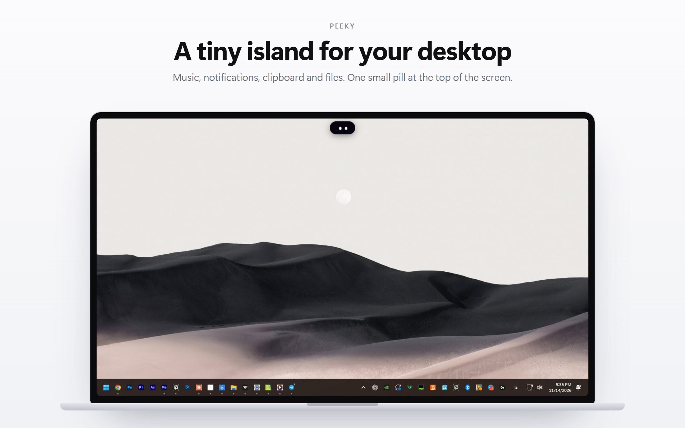

<div align="center">

# Peeky

**A tiny dynamic island for Windows.** One small pill at the top of your screen that shows what is playing,
catches your notifications, remembers what you copied, holds your files, and blinks at you in between.

[](https://github.com/raminturne/peeky/releases/latest)
[](https://github.com/raminturne/peeky/releases)
[](https://github.com/raminturne/peeky/actions/workflows/build.yml)

[](LICENSE)

[](https://github.com/raminturne/peeky/releases/latest/download/Peeky-Setup.exe)
[](https://github.com/raminturne/peeky/releases/latest/download/Peeky-Portable.exe)
[](https://github.com/raminturne/peeky/releases/latest/download/Peeky-Windows.zip)

[فارسی](#فارسی)



</div>

## What it does

- **Now playing.** Title, artist, cover, controls and a scrubber for whatever is playing on the system. Films and fullscreen games are left alone.
- **Themes that move.** Liquid skins that drift at rest and flood with colour on the beat (or stay calm, if you switch that off). In **Venom** the pill itself turns to black goo.
- **Local music.** Pick a folder once; the music button in the menu lists every track, a click plays it right on the pill (cover and title from the file's tags, shuffle, next/previous, scrubber). A small speaker button on the player opens a volume slider in place, inside the same pill.
- **Player window.** One click opens a small separate player: big cover, seek bar, volume, search and the full track list. The pill then leaves the music to it, and takes it back when the window is closed.
- **Notifications in one line.** Click to open that chat. While you are using the pill they wait beside it instead of taking it over.
- **One hover away.** Screenshot, text grab, clipboard history, quick note, passwords, timer, notifications, settings.
- **Smart copy.** A copied link can be opened, a sum gets its answer, a date its twin in the other calendar (Gregorian ⇄ Shamsi), a colour its swatch.
- **File shelf.** Drop files on the pill; up to five sit there side by side until you drag them out again.
- **Timer.** Stays in sight while it runs, even over a fullscreen app.
- **Settings inside the island.** No extra windows.

On its first start Peeky says hello and shows a list of everything it can do; it stays in the settings under *What Peeky can do*. A click on a row tries the thing itself.
And also:

- **Quick notes.** `Ctrl+Alt+N` from anywhere, type one line, Enter. A time in the line (`call Ali in 20m`, `at 18:30 gym`, «۱۰ دقیقه دیگه چای») turns it into a reminder.
- **Passwords.** Generate one, confirm, and it asks which site and which e-mail it is for. Stored encrypted with your Windows account (DPAPI); copies clear themselves from the clipboard after 30 seconds.
- **Text grab.** `Ctrl+Alt+T`, drag a box, and the text in it is on your clipboard. English is read by Windows' own OCR; Persian by a bundled Tesseract. Nothing leaves your machine.
- **Clipboard history** with images and pins.
- **Small signs.** A dot while the microphone or camera is in use, a line when the internet or a VPN goes up or down, Bluetooth devices and the charger.
- **Updates itself.** New releases are downloaded, checked against the project's signing key, and installed with one click.

## Install

Download **[Peeky-Setup.exe](https://github.com/raminturne/peeky/releases/latest/download/Peeky-Setup.exe)** and run it.
It installs for the current user only (no administrator prompt) and starts with Windows; both can be changed in the settings.

Windows 10 or 11 with the WebView2 runtime (already part of Windows 11 and of current Windows 10).

The installer is not code-signed, so Windows SmartScreen may ask once whether to run it.

## Privacy

Peeky makes no network requests except checking this repository for a new release (which can be switched off).
Notifications, clipboard contents, notes and passwords stay on your computer.

## Build it yourself

```
cd src-tauri
cargo build --release
```

The result is a single `peeky.exe` (about 5 MB). The installer is `installer/island.nsi` (NSIS).
Every push is built by [GitHub Actions](.github/workflows/build.yml); a tag `vX.Y.Z` publishes a release.

## Platforms

Windows today. A Linux version is being worked on; the backend talks to Windows directly for almost everything
(notifications, media session, clipboard, the click-through window), so it is a port, not a rebuild.

## License

[MIT](LICENSE). Bundles tesseract.js and Tesseract's Persian data (Apache 2.0).

---

<div dir="rtl">

## فارسی

**Peeky یک جزیرهٔ کوچک و زنده برای ویندوز است.** یک قرص کوچک بالای صفحه که آهنگ در حال پخش را نشان می‌دهد،
نوتیفیکیشن‌ها را می‌گیرد، چیزهایی که کپی کرده‌ای یادش می‌ماند، فایل‌هایت را نگه می‌دارد و بین این کارها پلک می‌زند.

### امکانات

- **پخش موزیک:** نام آهنگ، خواننده، کاور، دکمه‌های کنترل و نوار جلو و عقب بردن. با فیلم و بازی تمام‌صفحه کاری ندارد.
- **تم‌های متحرک:** کموهای مایع که آرام حرکت می‌کنند و با ضرب آهنگ پر از رنگ می‌شوند (می‌شود واکنش به موزیک را خاموش کرد).
- **ونوم:** خود جزیره به لجن سیاه زنده تبدیل می‌شود.
- **موزیک لوکال:** یک بار پوشهٔ موزیک را انتخاب کن؛ دکمهٔ موزیک در منو همهٔ آهنگ‌ها را فهرست می‌کند و با یک کلیک روی خود جزیره پخش می‌شود (کاور و نام از تگ فایل، شافل، قبلی و بعدی، نوار جلو و عقب). یک دکمهٔ کوچک بلندگو روی پلیر هست که نوار صدا را همان‌جا، داخل خود جزیره باز می‌کند.
- **پنجرهٔ پلیر:** با یک کلیک یک پلیر کوچک جدا باز می‌شود: کاور بزرگ، نوار پخش، صدا، جستجو و فهرست کامل آهنگ‌ها. تا وقتی بازست، جزیره موزیک را نشان نمی‌دهد و با بستنش دوباره برمی‌گرداند.
- **نوتیفیکیشن در یک خط:** با کلیک همان چت باز می‌شود. وقتی مشغول کار با جزیره‌ای، کنار آن منتظر می‌ماند.
- **کپی هوشمند:** لینکِ کپی‌شده باز می‌شود، حساب جواب می‌گیرد، تاریخ میلادی و شمسی به هم تبدیل می‌شوند.
- **نگه‌داشتن فایل:** فایل را روی جزیره رها کن؛ کنار هم می‌مانند تا دوباره بیرونشان بکشی.
- **یادداشت سریع:** `Ctrl+Alt+N` از هر جا. اگر در متن زمان باشد («۱۰ دقیقه دیگه چای») یادآور می‌شود.
- **رمزها:** رمز می‌سازد، سایت و ایمیل را می‌پرسد و ذخیره می‌کند (رمزنگاری‌شده با حساب ویندوز).
- **خواندن متن از صفحه:** `Ctrl+Alt+T`، دور متن کادر بکش؛ انگلیسی و فارسی. همه‌چیز روی سیستم خودت انجام می‌شود.
- **تایمر، تاریخچهٔ کپی با عکس، نشانگر میکروفون و دوربین، وضعیت اینترنت و VPN.**
- **راهنمای داخل برنامه:** بار اول خودش فهرست قابلیت‌ها را نشان می‌دهد؛ بعداً از تنظیمات، «What Peeky can do».
- **آپدیت خودکار:** نسخهٔ جدید دانلود، با کلید پروژه بررسی و با یک کلیک نصب می‌شود.

### نصب

فایل **[Peeky-Setup.exe](https://github.com/raminturne/peeky/releases/latest/download/Peeky-Setup.exe)** را دانلود و اجرا کن.
فقط برای کاربر فعلی نصب می‌شود و دسترسی ادمین نمی‌خواهد.

### حریم خصوصی

Peeky هیچ درخواست اینترنتی‌ای نمی‌فرستد، به‌جز بررسی همین مخزن برای نسخهٔ جدید (که می‌شود خاموشش کرد).
نوتیفیکیشن‌ها، کلیپ‌بورد، یادداشت‌ها و رمزها روی سیستم خودت می‌مانند.

</div>
